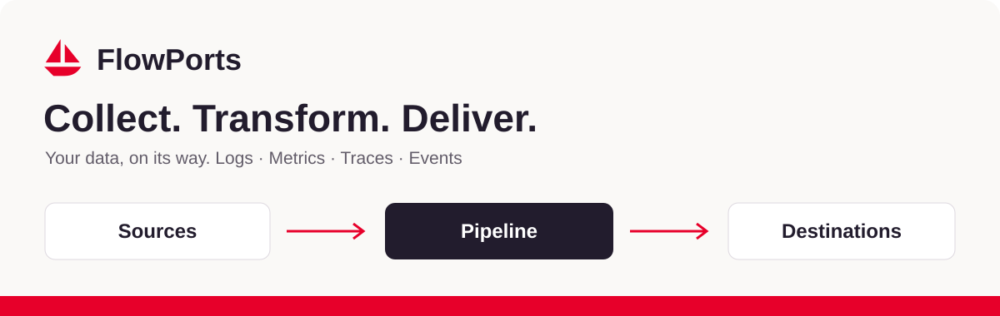
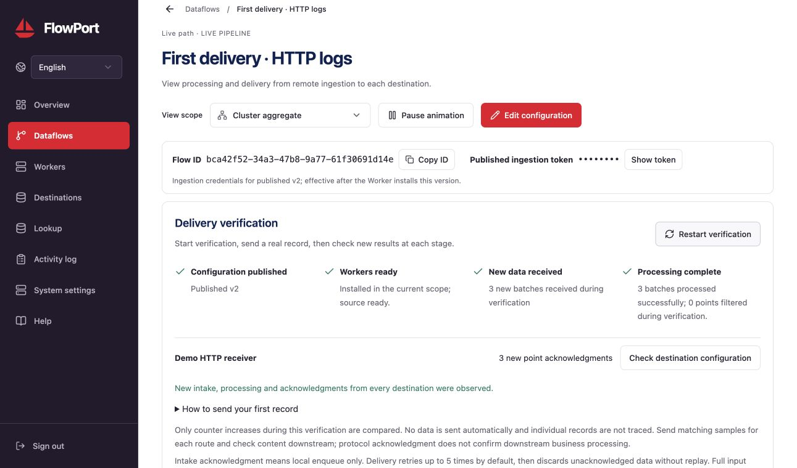

[English](README.md) · [简体中文](README.zh-CN.md) · [繁體中文](README.zh-TW.md) · [日本語](README.ja.md) · [한국어](README.ko.md)

# データをつなぎ、処理し、必要な場所へ届ける。

ログ、メトリクス、トレース、イベントを **Source → Pipeline → Destinations** で処理し、観測・分析システムへ転送します。

**[公式サイト](https://flowport.pages.dev/ja/) · [はじめに](https://flowport.pages.dev/ja/docs/) · [Linux ダウンロード](https://flowport.pages.dev/ja/downloads/) · [リリースノート](https://flowport.pages.dev/ja/changelog/#v0-5-3)**

## 0.5.3 の更新

- 送信先や容量の割り当てが未設定でも下書きを保存できます。公開時には完全な設定を検証します。
- フローのエディター内で送信先を作成・選択できます。入力したソースや Pipeline の設定を維持します。
- 公開後の新規受信、処理、全送信先の確認を検証します。既存の滞留や過去の成功は今回の結果に含めません。

## ソースから配信まで、ひとつの経路

| 収集 | 処理 | 配信 |
| --- | --- | --- |
| アプリ、インフラ、データベース、メッセージ基盤、クラウド向けの 72 種類の Source。 | Pipeline で解析・変換し、ローカル Lookup で補完。Tag ルーティングと上限付きキャッシュ・ウィンドウを利用できます。 | 48 種類の Destination。出力チャネルを独立させ、実行画面で確認、滞留、異常を表示します。 |

*FlowPort 0.5.3 をローカル Chrome で撮影。実際の HTTP レコードが受信・処理され、ローカル受信先が確認しました。隔離テスト環境の合成データを使用し、認証情報はマスクしています。*

## 最初のレコードを届ける

1. [Linux パッケージをダウンロード](https://flowport.pages.dev/ja/downloads/)し、SHA-256 を確認します。amd64 / arm64 の deb、rpm、tar.gz を提供。実行に Node.js、npm、Go コンパイラーは不要です。
2. Web 初期設定を完了し、データフローを作成してソースを選択します。下書きはいつでも保存できます。変換が不要なら空の Pipeline でそのまま転送します。
3. エディターで送信先を追加して公開し、Worker のインストールを待ちます。配信検証を開始してからサンプルを送り、送信先で実データを確認します。

## 実用ガイド

- **[データフローとルーティング](docs/ja/flows.md)** — 作成、保存、公開、フロー設定のインポートとエクスポート。
- **[Lookup データ補完](docs/ja/lookup.md)** — ローカル照合、バックグラウンド同期、不変データバージョン。
- **[Pipeline とウィンドウ](docs/ja/pipeline.md)** — 解析、短期間の重複排除、コンテキスト、集約。

[ドキュメント一覧](docs/index.md) · [配信と復旧](https://flowport.pages.dev/ja/docs/delivery/) · [エディションとライセンス](https://flowport.pages.dev/ja/editions/)

## 配信の境界を理解する

- 取り込み確認は現在の Worker での永続受理を示し、送信先への配信は保証しません。Worker のキューは独立し、ノード間で複製しません。
- 送信先への初回送信後、既定で最大 **5 回再試行**します。使い切ると未確認データを破棄し、デッドレター再送はできません。その後は少なくとも 60 秒待って 1 バッチを試送します。
- 新規フローの既定は Worker ごとに **256 MiB・内部 500 バッチ**。入力と各送信先へ固定配分します。入力が満杯なら受理を拒否し、出力が満杯ならそのチャネルだけで削除可能な最古のデータを破棄します。既存の明示的な割り当ては変更しません。
- プロトコル確認は下流の業務処理完了を意味しません。確認の消失で重複が起こり得ます。厳密な一度限りの送信や送信先をまたぐトランザクションは保証しません。

### 更新する前に

0.5.3 は制御プロトコル **v8**、チェックポイント形式 **3** を使用します。全ノードのデータ、master.key、Lookup、環境設定を完全にバックアップしてから、管理サーバーと実行 Worker をまとめて更新してください。既存の滞留は再試行回数を維持します。内部 HTTP 読み取りにはノードごとの必要な CIDR 許可が必要です。

## 質問とフィードバック

製品の質問、再現可能な問題、文書の修正は [Issues](https://github.com/SamuelSupe/flowport/issues/new/choose) へ。バージョンと機密情報を除いた例を添えてください。

---

ここは公開ドキュメントの入口です。公式サイトのブランドは FlowPorts、インストールするソフトウェアは FlowPort です。製品・サイトのソース、ソース履歴、バイナリーは公開していません。コミュニティ版はローカル Worker 1 台。商用の複数 Worker 構成には発行元のビルドとライセンスが必要です。
