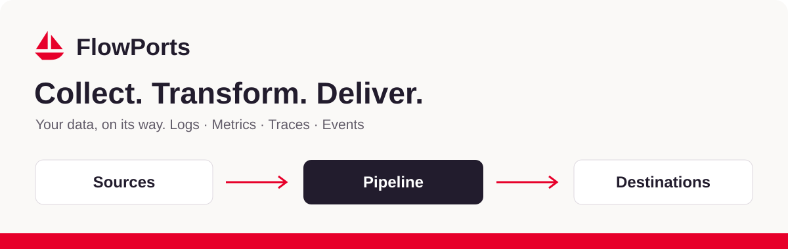
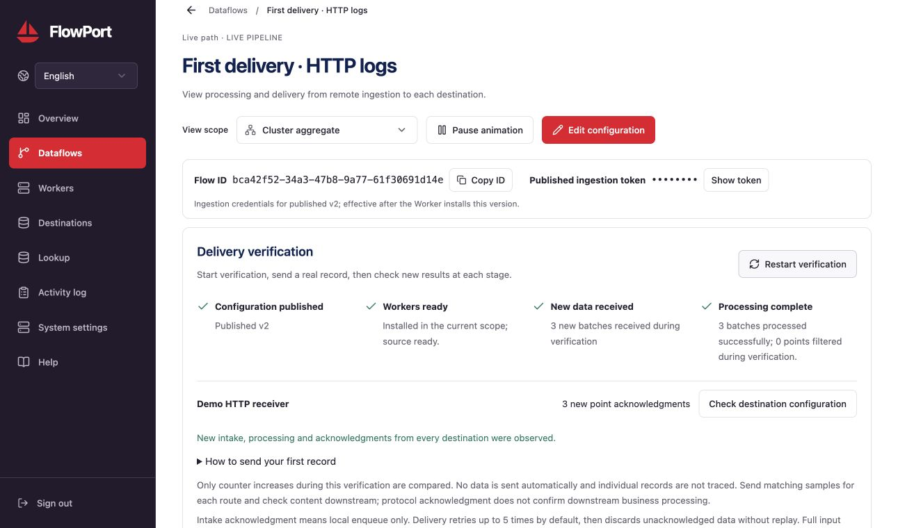

[English](README.md) · [简体中文](README.zh-CN.md) · [繁體中文](README.zh-TW.md) · [日本語](README.ja.md) · [한국어](README.ko.md)

# 데이터를 연결하고 처리하여 필요한 곳으로 전달하세요.

로그, 메트릭, 트레이스와 이벤트를 **Source → Pipeline → Destinations**로 처리하여 관측 및 분석 시스템에 전달합니다.

**[공식 사이트](https://flowport.pages.dev/ko/) · [시작하기](https://flowport.pages.dev/ko/docs/) · [Linux 다운로드](https://flowport.pages.dev/ko/downloads/) · [릴리스 노트](https://flowport.pages.dev/ko/changelog/#v0-5-8)**

## 0.5.8 업데이트

- Source 설정이 같으면 기존 TCP 및 UDP Socket 리스너가 계속 동작합니다. Worker가 새 버전을 설치하면 기존 TCP 연결에서도 새로 수락된 레코드는 새 Pipeline을 사용합니다. 대기 중인 배치는 기존 버전을 유지합니다.
- 입력 큐가 가득 차면 TCP Socket, Syslog 및 StatsD는 해당 연결을 닫고 디코딩 이후 영속 큐에 들어가지 못한 레코드를 집계합니다. 실행 화면에서 거부 이유를 볼 수 있으며, API는 source_rejected_records, Prometheus는 collectway_flow_source_rejected_records_total을 제공합니다. 이미 수락된 배치는 큐에 보존됩니다.

## 소스에서 전달까지 하나의 경로

| 수집 | 처리 | 전달 |
| --- | --- | --- |
| 애플리케이션, 인프라, 데이터베이스, 메시지 시스템과 클라우드를 위한 72가지 Source. | Pipeline으로 파싱하고 변환하며 로컬 Lookup으로 보강합니다. Tag 라우팅과 제한된 캐시·창 상태를 지원합니다. | 48가지 Destination. 독립 출력 채널과 실행 화면에서 확인, 적체 및 오류를 살펴봅니다. |

*로컬 Chrome에서 촬영한 FlowPort 0.5.3입니다. 실제 HTTP 레코드를 수신·처리하고 로컬 수신기가 확인했습니다. 격리된 테스트 환경과 합성 데이터를 사용하며 인증 정보는 가렸습니다.*

## 첫 번째 레코드를 전달하세요

1. [Linux 패키지 다운로드](https://flowport.pages.dev/ko/downloads/) 후 SHA-256을 확인하세요. amd64 / arm64의 deb, rpm, tar.gz를 제공합니다. 실행에 Node.js, npm 또는 Go 컴파일러가 필요하지 않습니다.
2. Web 초기 설정을 완료하고 데이터 흐름과 소스를 선택하세요. 언제든 초안을 저장할 수 있으며, 변환이 필요 없으면 빈 Pipeline으로 그대로 전달합니다.
3. 편집기에서 목적지를 추가하고 게시한 뒤 Worker 설치를 기다리세요. 전달 검증을 시작한 후 일치하는 샘플을 보내고 목적지의 실제 데이터를 확인하세요.

## 사용 가이드

- **[데이터 흐름과 라우팅](docs/ko/flows.md)** — 생성, 저장, 게시 및 단일 흐름 설정 가져오기/내보내기.
- **[Lookup 데이터 보강](docs/ko/lookup.md)** — 로컬 매칭, 백그라운드 동기화 및 불변 데이터 버전.
- **[Pipeline과 창](docs/ko/pipeline.md)** — 파싱, 단기 중복 제거, 컨텍스트와 집계.

[전체 문서](docs/index.md) · [전달과 복구](https://flowport.pages.dev/ko/docs/delivery/) · [에디션과 라이선스](https://flowport.pages.dev/ko/editions/)

## 전달의 경계 이해하기

- 수신 확인은 현재 Worker의 영구 수락을 뜻하며 목적지 전달을 보장하지 않습니다. Worker 큐는 독립적이며 노드 간 복제되지 않습니다.
- 최초 전송 이후 대상별 빠른 재시도는 기본 5회입니다. 빠른 재시도가 끝나면 미확인 데이터를 큐에 유지하고 최소 60초 뒤 배치 하나를 시험 전송합니다.
- 새 흐름의 기본값은 Worker당 256 MiB, 내부 배치 500개입니다. 입력과 대상별로 분리합니다. 출력 큐가 가득 차면 원본 입력을 유지하고 입력 큐가 가득 차면 새 수집을 거부합니다.
- 프로토콜 확인은 하위 시스템의 업무 처리 완료를 뜻하지 않습니다. 확인 손실로 중복이 발생할 수 있으며, 엄격한 단 한 번 전송이나 목적지 간 트랜잭션을 보장하지 않습니다.

### 업그레이드 전

0.5.8은 제어 프로토콜 v9와 체크포인트 형식 3을 사용합니다. 각 노드의 전체 데이터 디렉터리, master.key, Lookup 리소스와 환경 설정을 백업한 뒤 관리자와 모든 Worker를 함께 업데이트하세요.

## 질문과 피드백

제품 질문, 재현 가능한 문제 또는 문서 수정은 [Issues](https://github.com/SamuelSupe/flowport/issues/new/choose)에 버전과 민감 정보를 제거한 예시를 첨부하세요.

---

이 저장소는 공개 문서 허브입니다. 공식 사이트 브랜드는 FlowPorts이며 설치하는 소프트웨어는 FlowPort입니다. 제품·사이트 소스, 소스 이력 또는 바이너리를 호스팅하지 않습니다. 커뮤니티 패키지는 로컬 Worker 1개를 지원하며 상용 다중 Worker 배포에는 발행자의 빌드와 라이선스가 필요합니다.
