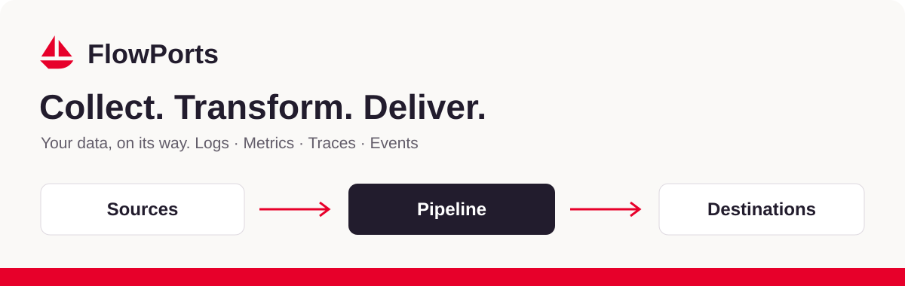
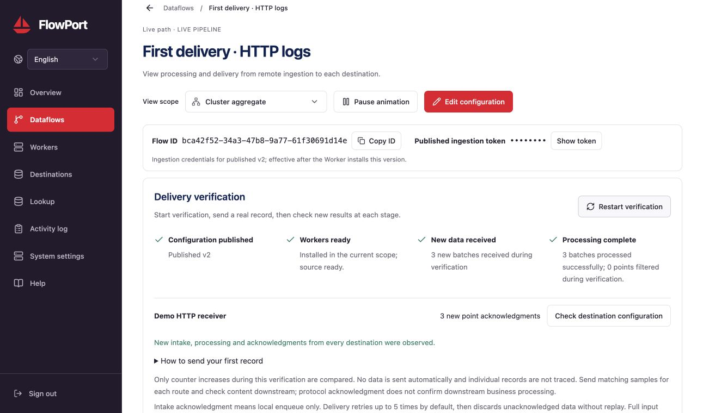

[English](README.md) · [简体中文](README.zh-CN.md) · [繁體中文](README.zh-TW.md) · [日本語](README.ja.md) · [한국어](README.ko.md)

# Connect your data sources to the systems that need them.

Collect, process and route logs, metrics, traces and events through **Source → Pipeline → Destinations**.

**[Website](https://flowport.pages.dev/en/) · [Get started](https://flowport.pages.dev/en/docs/) · [Linux downloads](https://flowport.pages.dev/en/downloads/) · [Release notes](https://flowport.pages.dev/en/changelog/#v0-5-9)**

## New in 0.5.9

- Intake diagnostics distinguish rejected records from decode drops. Kafka, object notifications, paginated audit sources and Kubernetes listing preserve or validate progress when resuming.
- Delivery keeps valid partial receipts and retries unconfirmed records. Writes without a protocol receipt are counted as sent_without_receipt.
- Supported destinations persist Retry-After alongside local backoff. Queue-head diagnostics show the effective retry time.

## One path, from source to delivery

| Collect | Transform | Deliver |
| --- | --- | --- |
| 72 Source types for application, infrastructure, database, broker and cloud data. | Parse and enrich with Pipeline, local Lookup data, tag routing and bounded cache/window state. | 49 Destination types, independent output channels and runtime delivery status. |

*FlowPort 0.5.3 in native Chrome: real HTTP records received, processed and acknowledged by a local receiver. Isolated test instance with synthetic data; credentials are masked.*

## Get your first record delivered

1. [Download a Linux package](https://flowport.pages.dev/en/downloads/) and verify its SHA-256. amd64 and arm64 are available as deb, rpm and tar.gz. No Node.js, npm or Go compiler is needed to run it.
2. Complete Web setup, create a dataflow and choose the source. Save a draft whenever you need; Pipeline processing is optional.
3. Add a destination in the editor, publish and wait for Worker installation. Start delivery verification, send a matching sample and inspect the actual data downstream.

## Practical guides

- **[Flows and routing](docs/en/flows.md)** — Create, save, publish and import/export a flow.
- **[Lookup enrichment](docs/en/lookup.md)** — Local matching, background sync and pinned data versions.
- **[Pipeline and windows](docs/en/pipeline.md)** — Parsing, short-term deduplication, context and aggregation.

[All documentation](docs/index.md) · [Delivery and recovery](https://flowport.pages.dev/en/docs/delivery/) · [Editions and licensing](https://flowport.pages.dev/en/editions/)

## Know the delivery boundaries

- Intake acknowledgment confirms durable acceptance on the current Worker, not destination delivery. Worker queues are independent and are not replicated.
- After the initial send, each destination defaults to five fast retries. When those retries are exhausted, unconfirmed data stays queued and the channel waits at least 60 seconds before probing one batch.
- New flows default to 256 MiB and 500 internal batches per Worker, partitioned between input and destinations. A full output keeps its upstream input queued. A full input rejects new intake.
- Protocol receipts do not prove downstream business processing. Lost acknowledgments can produce duplicates; there is no strict exactly-once or cross-destination transaction guarantee.

### Before upgrading

0.5.9 uses control protocol v9 and checkpoint format 3. Stop intake and back up each node’s data, master.key, Lookup resources and environment configuration before upgrading the manager and all Workers together. To roll back, restore the pre-upgrade backup.

## Questions and feedback

Use [Issues](https://github.com/SamuelSupe/flowport/issues/new/choose) for product questions, reproducible problems or documentation corrections. Include your version and a redacted example.

---

This is the public documentation hub. FlowPorts is the website brand; the installed software remains FlowPort. Product source, website source, source history and binaries are not hosted here. Community packages support one local Worker; commercial multi-Worker deployments require a publisher-provided build and license.
