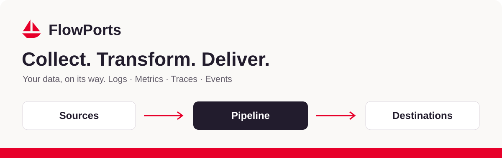
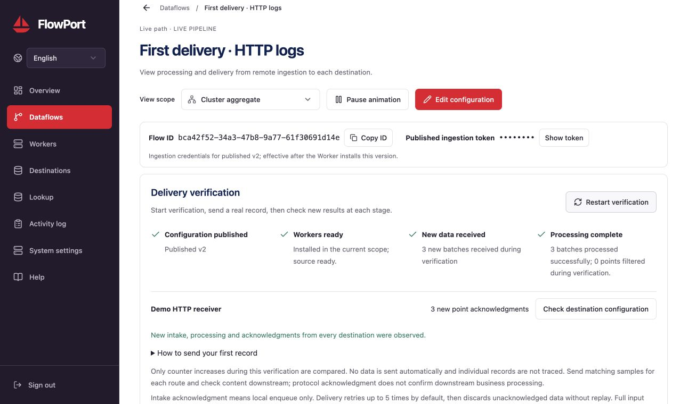

[English](README.md) · [简体中文](README.zh-CN.md) · [繁體中文](README.zh-TW.md) · [日本語](README.ja.md) · [한국어](README.ko.md)

# 连接、处理，让数据抵达需要它的地方。

把日志、指标、链路与事件接入 **Source → Pipeline → Destinations**，在来源与观测、分析系统之间完成处理和转发。

**[官网](https://flowport.pages.dev/) · [快速开始](https://flowport.pages.dev/docs/) · [Linux 下载](https://flowport.pages.dev/downloads/) · [版本说明](https://flowport.pages.dev/changelog/#v0-5-8)**

## 0.5.8 更新

- Socket 来源设置相同时，原有 TCP 和 UDP 监听器继续运行。Worker 安装新版后，即使沿用原 TCP 连接，新入队记录也使用新版 Pipeline。积压批次沿用入队时的版本。
- 输入队列满时，TCP Socket、Syslog 和 StatsD 关闭受影响的连接，并统计已解码但未持久入队的记录。运行视图显示拒收原因，API 提供 source_rejected_records，Prometheus 提供 collectway_flow_source_rejected_records_total。已入队积压继续保留。

## 从来源到送达，一条完整路径

| 接入 | 处理 | 发送 |
| --- | --- | --- |
| 72 种 Source，覆盖应用、基础设施、数据库、消息系统和云服务。 | 通过 Pipeline 解析和转换，使用本地 Lookup 富化，按 Tag 分流，并支持有界缓存与窗口。 | 49 种 Destination，目标通道独立投递，在运行页查看确认、积压与异常。 |

*FlowPort 0.5.3 本机 Chrome 实拍：HTTP 数据完成接收、处理与本地目标确认。使用隔离测试实例与合成数据，凭证保持打码。*

## 让第一条数据走通

1. [下载 Linux 安装包](https://flowport.pages.dev/downloads/)并核对 SHA-256。支持 amd64 / arm64 的 deb、rpm 和 tar.gz，安装运行无需 Node.js、npm 或 Go 编译器。
2. 完成 Web 初始化，创建数据流并选择来源。可以随时保存草稿；不需要转换时，空 Pipeline 直接透传。
3. 在编辑器添加目标，发布并等待 Worker 安装。先开始送达验证，再发送匹配样本，最后在下游核对实际内容。

## 使用指南

- **[数据流与路由](docs/zh-CN/flows.md)** — 创建、保存、发布，以及单流配置导入导出。
- **[Lookup 数据富化](docs/zh-CN/lookup.md)** — 本地匹配、后台同步与不可变数据版本。
- **[Pipeline 与窗口](docs/zh-CN/pipeline.md)** — 解析、短期去重、上下文和窗口聚合。

[完整文档目录](docs/index.md) · [交付与恢复](https://flowport.pages.dev/docs/delivery/) · [版本与授权](https://flowport.pages.dev/editions/)

## 清楚理解交付边界

- 接入确认只表示当前 Worker 已持久接受，不等于目标送达。各 Worker 队列独立，不跨节点复制。
- 目的端首次发送后默认快速重试 5 次。快速重试耗尽后保留未确认数据，通道至少等待 60 秒，再试投一批。
- 新数据流默认每 Worker 256 MiB 和 500 个内部批次，分配给输入和各目的端。输出区满时保留原输入，输入区满时拒收新数据。
- 协议确认不等于下游业务处理完成。确认丢失可能导致重复，不保证严格只发送一次或跨目标事务。

### 升级前

0.5.8 使用控制协议 v9、检查点格式 3。先备份各节点的完整数据目录、master.key、Lookup 资源与环境配置，再协调更新管理端和全部 Worker。

## 问题与反馈

通过 [Issues](https://github.com/SamuelSupe/flowport/issues/new/choose)反馈产品问题、可复现故障或文档修正，请附版本和脱敏示例。

---

这里是公开文档入口。官网品牌为 FlowPorts，安装的软件仍使用 FlowPort 名称。本仓库不包含产品源码、官网源码、源码历史或安装包。社区包提供单本机 Worker；商业多 Worker 部署需要发行方提供的构建与授权。
