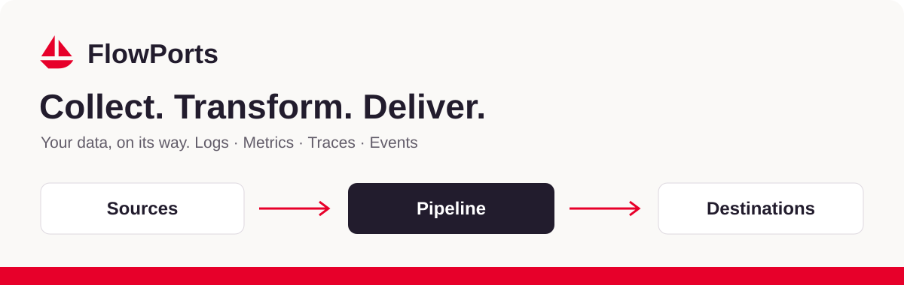
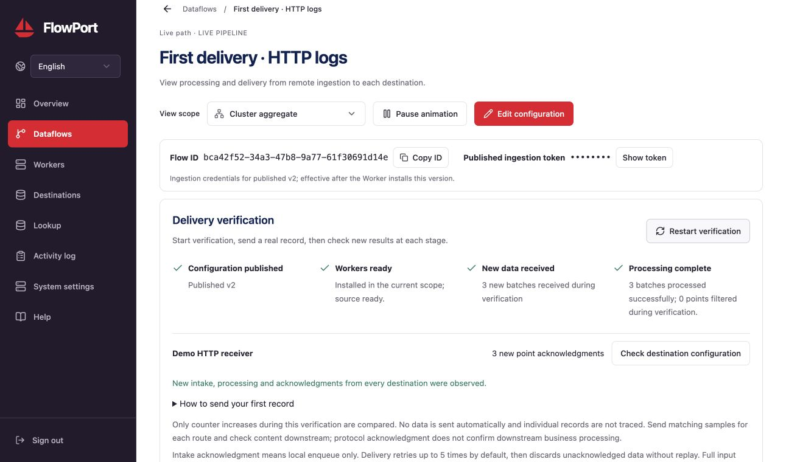

[English](README.md) · [简体中文](README.zh-CN.md) · [繁體中文](README.zh-TW.md) · [日本語](README.ja.md) · [한국어](README.ko.md)

# 連接、處理，讓資料抵達需要它的地方。

將日誌、指標、追蹤與事件接入 **Source → Pipeline → Destinations**，在來源與觀測、分析系統之間完成處理和轉送。

**[官網](https://flowport.pages.dev/zh-TW/) · [快速開始](https://flowport.pages.dev/zh-TW/docs/) · [Linux 下載](https://flowport.pages.dev/zh-TW/downloads/) · [版本說明](https://flowport.pages.dev/zh-TW/changelog/#v0-5-9)**

## 0.5.9 更新

- 接入診斷區分拒收與解碼丟棄。Kafka、物件通知、分頁稽核來源和 Kubernetes 清單在續讀時儲存或驗證進度。
- 投遞保留有效的部分回執，只重試未確認的資料。缺少協定回執的寫出計入 sent_without_receipt。
- 支援的目的端會將 Retry-After 與本機退避一併持久化。佇列頭部診斷顯示實際重試時間。

## 從來源到送達，一條完整路徑

| 接入 | 處理 | 傳送 |
| --- | --- | --- |
| 72 種 Source，涵蓋應用、基礎設施、資料庫、訊息系統與雲端服務。 | 透過 Pipeline 解析和轉換，使用本機 Lookup 補充資料，依 Tag 分流並支援有界快取與視窗。 | 49 種 Destination，目的端通道獨立投遞，在執行頁查看確認、積壓與異常。 |

*FlowPort 0.5.3 本機 Chrome 實拍：HTTP 資料完成接收、處理與本機目的端確認。使用隔離測試實例及合成資料，憑證維持遮罩。*

## 讓第一筆資料走通

1. [下載 Linux 安裝包](https://flowport.pages.dev/zh-TW/downloads/)並核對 SHA-256。支援 amd64 / arm64 的 deb、rpm 與 tar.gz，安裝及執行不需 Node.js、npm 或 Go 編譯器。
2. 完成 Web 初始化，建立資料流並選擇來源。可隨時儲存草稿；不需要轉換時，空 Pipeline 直接透傳。
3. 在編輯器新增目的端，發佈並等待 Worker 安裝。先開始送達驗證，再傳送符合路由的範例，最後在下游核對實際內容。

## 使用指南

- **[資料流與路由](docs/zh-TW/flows.md)** — 建立、儲存、發佈與單一資料流設定匯入匯出。
- **[Lookup 資料補充](docs/zh-TW/lookup.md)** — 本機比對、背景同步與不可變資料版本。
- **[Pipeline 與視窗](docs/zh-TW/pipeline.md)** — 解析、短期去重、上下文與視窗聚合。

[完整文件目錄](docs/index.md) · [交付與復原](https://flowport.pages.dev/zh-TW/docs/delivery/) · [版本與授權](https://flowport.pages.dev/zh-TW/editions/)

## 清楚理解交付邊界

- 接入確認僅表示目前 Worker 已持久接受，不等於目的端送達。各 Worker 佇列獨立，不跨節點複寫。
- 目的端首次傳送後預設快速重試 5 次。快速重試耗盡後保留未確認資料，通道至少等待 60 秒，再試投一批。
- 新資料流預設每個 Worker 256 MiB 和 500 個內部批次，分配給輸入和各目的端。輸出區滿時保留原輸入，輸入區滿時拒收新資料。
- 協定確認不等於下游業務處理完成。確認遺失可能導致重複，不保證嚴格僅傳送一次或跨目的端交易。

### 升級前

0.5.9 使用控制協定 v9、檢查點格式 3。升級前停止接入，備份各節點的資料、master.key、Lookup 和環境設定，再協調升級管理端與所有 Worker。回復舊版時還原升級前的備份。

## 問題與回饋

透過 [Issues](https://github.com/SamuelSupe/flowport/issues/new/choose)回報產品問題、可重現故障或文件修正，請附版本與已去除敏感資料的範例。

---

這裡是公開文件入口。官網品牌為 FlowPorts，安裝的軟體仍使用 FlowPort 名稱。本儲存庫不包含產品原始碼、官網原始碼、原始碼歷史或安裝包。社群版提供單一本機 Worker；商業多 Worker 部署需要發行方提供的組建與授權。
